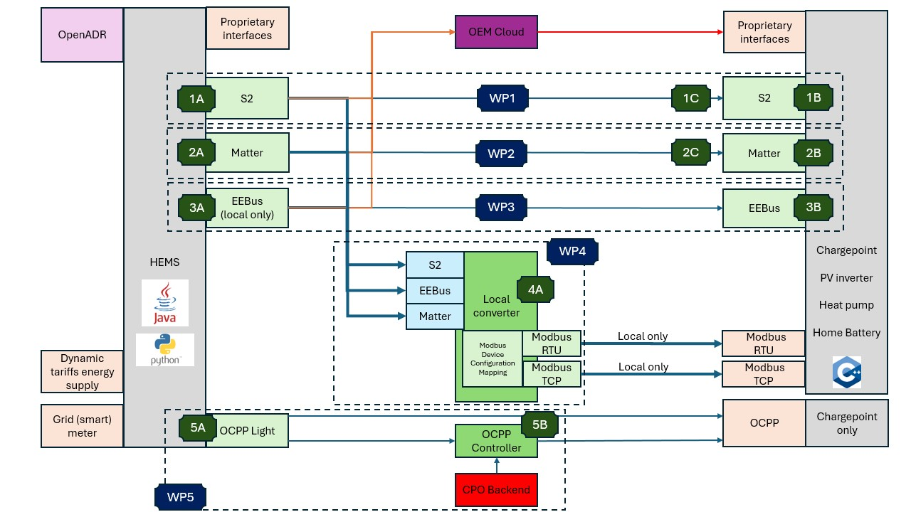

<!--
SPDX-FileCopyrightText: ElaadNL

SPDX-License-Identifier: Apache-2.0
-->

# Project overview

resflex-open-eebus-connector is an open-source C11 SDK for EEBus communication between
a local energy coordinator and flexible devices (EV charger, heat pump, PV
inverter). It implements SHIP 1.0.1, a SPINE 1.3.0 subset, and the LPC / LPP
use cases.



---

## What this repository is

This repository **contains the connector implementation**: `libeebus.a`, unit
tests, and four demo programs. It is not a documentation-only template.

| Layer | Role in this project |
| --- | --- |
| Application / demos | Control box (Energy Guard) and three Controllable Systems |
| Use case | LPC (consumption limit) and LPP (production limit) |
| SPINE | Discovery, bind/subscribe, LoadControl, DeviceConfiguration, DeviceDiagnosis, ElectricalConnection |
| SHIP | mDNS, TLS identity (SKI), WebSocket handshake, SPINE payload transport |

Coverage details: [spec-coverage.md](./spec-coverage.md).

---

## Protocol stack

```text
+-----------------------------------------------------------------+
|  Use case (LPC, LPP)                                            |
|  Controllable System state machine, Energy Guard writes         |
+-----------------------------------------------------------------+
|  SPINE                                                          |
|  Device model, NodeManagement discovery, subscriptions/bindings |
|  Feature codecs (JSON <-> C structs)                            |
+-----------------------------------------------------------------+
|  SHIP                                                           |
|  Node, handshake state machine, SKI trust                       |
+-----------------------------------------------------------------+
|  Transport                                                      |
|  WebSocket (libwebsockets) + TLS (OpenSSL) + TCP/IP             |
+-----------------------------------------------------------------+
```

SHIP finds peers and authenticates them. SPINE describes devices, features,
and use cases. LPC/LPP put a power limit (and failsafe/heartbeat) on top of
LoadControl.

---

## Roles in this connector

EEBus LPC/LPP define two actors:

- **Energy Guard (EG)** — writes limits, failsafe configuration, and
  heartbeats. In this tree: `eebus-controlbox`.
- **Controllable System (CS)** — applies limits, reports state, enters
  failsafe if the heartbeat is lost. In this tree: heat pump and EV charger
  (LPC), PV inverter (LPP).

The control box can talk to several CS devices at once. There is no combined
CS+EG (cascading HEMS) demo.

---

## Programme context

This work is part of the Dutch National Grid Congestion Action Program
(ElaadNL and FAN). The programme develops open-source connectors between a
Home Energy Management System (HEMS) and flexible energy-intensive devices,
using open protocols (S2, Matter, EEBus, Modbus, OCPP). Connectors are
Apache 2.0 and published under the ElaadNL GitHub organisation.

In that picture the HEMS (or a grid-side control box) is the coordinator.
This repository is the **EEBus (SHIP/SPINE)** connector: it carries LPC/LPP
limits to devices. It does not ingest DSO capacity curves or market prices
by itself.

How LPC/LPP relate to the three flexibility goals:
[use-cases.md](./use-cases.md).
