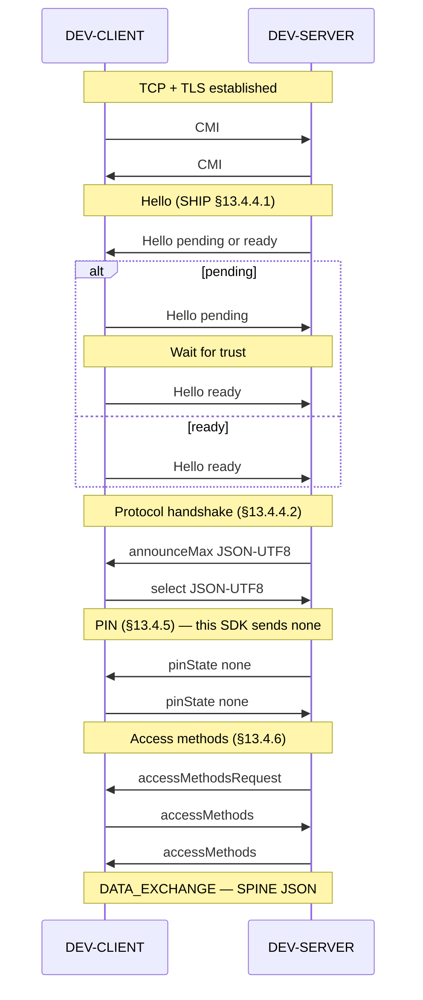
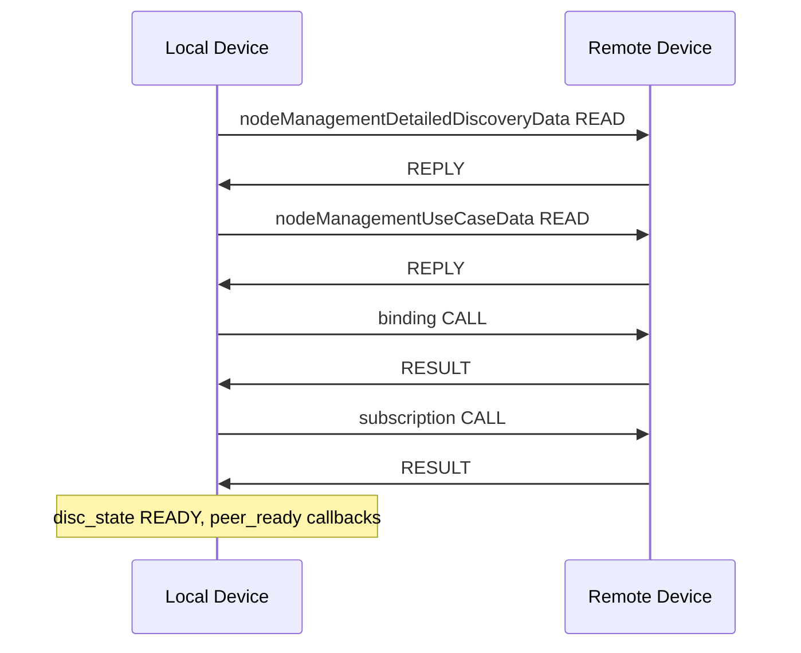
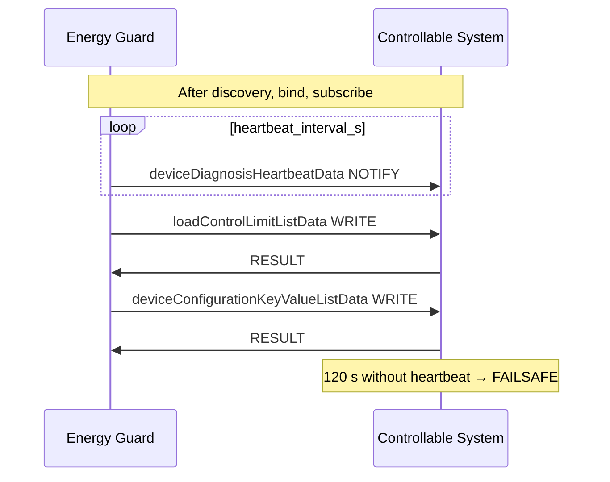
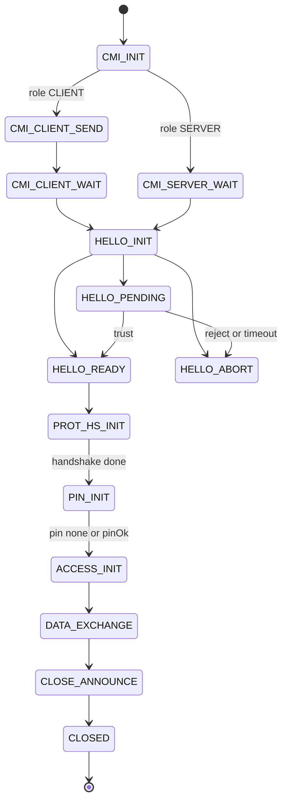
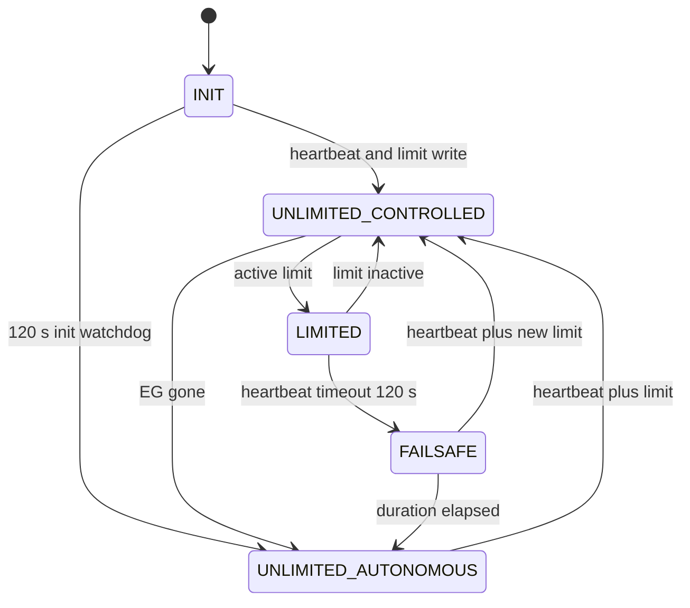

<!--
SPDX-FileCopyrightText: ElaadNL

SPDX-License-Identifier: Apache-2.0
-->

# resflex-open-eebus-connector design

## 1. Introduction

resflex-open-eebus-connector is a C11 implementation of the EEBus stack: SHIP 1.0.1
and a SPINE 1.3.0 subset, plus LPC 1.0.0 and LPP 1.0.0. It builds a static
library (`libeebus.a`) for control boxes and Controllable Systems (heat pump,
EV charger, PV inverter).

What is in and out of scope: [spec-coverage.md](./spec-coverage.md).

**License:** Apache-2.0 (REUSE). **Build:** CMake + Ninja. **Dependencies:**
libwebsockets, cJSON, Avahi client, OpenSSL, pthread, librt.

---

## 2. Project structure

```text
resflex-open-eebus-connector/
├── CMakeLists.txt
├── sources.cmake
├── src/
│   ├── common/          # eebus_error, eebus_memory, eebus_vector
│   ├── log/             # eebus_log
│   ├── platform/        # thread / mutex / timer APIs
│   │   └── linux/
│   ├── ship/            # SHIP 1.0.1
│   │   ├── ship_node.h/c
│   │   ├── connection/ship_connection.h/c
│   │   ├── model/ship_model.h/c
│   │   ├── mdns/        # ship_mdns.h, ship_mdns_avahi.c
│   │   ├── tls/         # ship_tls.h, ship_tls_openssl.c
│   │   └── websocket/   # ship_ws.h, ship_ws_lws.c
│   ├── spine/
│   │   ├── spine_device.h/c
│   │   ├── spine_router.h/c
│   │   ├── spine_node_mgmt.h/c
│   │   ├── spine_sub_bind.h/c
│   │   └── codec/       # datagram, NM, LoadControl, DeviceCfg/Diag, EC, Measurement, RFE
│   └── uc/              # uc_lc, uc_lc_cs, uc_lc_eg + LPC/LPP wrapper headers
├── examples/
│   ├── common/          # ship_helper, tls_persist, trust, cli, dashboard, device_table, …
│   ├── controlbox/      # LPC+LPP EG, port 7711
│   ├── heatpump/        # LPC CS, port 7713
│   ├── evcharger/       # LPC CS, port 7714
│   └── pvinverter/      # LPP CS, port 7715
├── tests/               # Google Test (C++)
├── EEBUSspec/           # EEBus XSDs + public use-case PDFs
└── docs/
```

---

## 3. Module architecture

### 3.1 Common (`src/common/`)

`eebus_error.h` — `eebus_err_t` is `int`. Success is `EEBUS_OK` (0); errors
are negative. Groups include generic (`EEBUS_ERR_INVALID`, `EEBUS_ERR_NO_MEMORY`,
`EEBUS_ERR_STATE`, …), TLS (`EEBUS_ERR_TLS`, `EEBUS_ERR_CERT`), SHIP handshake,
and a few SPINE/UC codes. Use `eebus_err_str()`.

`eebus_memory.h` — `EEBUS_MALLOC` / `EEBUS_FREE` / `EEBUS_CALLOC` /
`EEBUS_REALLOC` (overridable at link time).

`eebus_vector.h` — dynamic `void**` array (`init`, `push`, `pop`, `get`,
`destroy`).

### 3.2 Log (`src/log/`)

Levels: `EEBUS_LOG_DEBUG`, `INFO`, `WARN`, `ERROR`, `FATAL`. File rotation by
size and/or time. Macros take a tag then a format:
`EEBUS_LOG_INFO("ship_node", "…")`. Untrusted strings can be passed through
`eebus_log_sanitize()`; `eebus_log_write()` also strips C0 controls.

### 3.3 Platform (`src/platform/`)

| Abstraction | Linux backend |
| --- | --- |
| Thread | `pthread_create` / `pthread_join` |
| Mutex | recursive `pthread_mutex` |
| Timer | `timerfd` (one-shot or periodic) |

A SHIP connection uses several timers (hello, CMI, protocol handshake, PIN
watchdog, close, access-methods).

### 3.4 SHIP (`src/ship/`)

**`ship_node_t`** — TLS, mDNS, WebSocket server and client, up to 16
concurrent connections, SKI whitelist, auto-accept window, reconnect.

**`ship_conn_t`** — SHIP §13.4 handshake (see section 5.1).

**`ship_model`** — control-message JSON. Frame type byte then payload.
Handshake messages use type `0x01`; SPINE data uses `0x02`; CMI is a
one-byte init (`0x00` in the model header comments). See `ship_model.h`.

**Backends:** Avahi mDNS, OpenSSL TLS, libwebsockets.

### 3.5 SPINE (`src/spine/`)

**`spine_device_t`** — local device (features, entities, use-case entries) or
remote mirror created by the router on SHIP connect.

**`spine_router_t`** — one local device, up to 32 remotes, keyed by
`session_id`. Outbound JSON goes through `spine_send_fn_t`.

**`spine_node_mgmt_t`** — NodeManagement: DetailedDiscovery, UseCaseData,
bind, subscribe.

**`spine_sub_bind_t`** — subscription and binding tables (notify fan-out).

**Codecs** (JSON ↔ C structs):

| Module | SPINE functions |
| --- | --- |
| `spine_codec_address` | device / entity / feature address |
| `spine_codec_msg` / `datagram` | header + payload |
| `spine_codec_result` | `resultData` |
| `spine_codec_load_ctrl` | limit list + limit description |
| `spine_codec_dev_cfg` | deviceConfiguration key-value |
| `spine_codec_dev_diag` | heartbeat + state |
| `spine_codec_elec_conn` | EC description, parameter, characteristic, permitted set |
| `spine_codec_measurement` | measurement list + description (codec only) |
| `spine_codec_node_mgmt` | DetailedDiscovery, UseCaseData |
| `spine_codec_sub_bind` | binding / subscription requests |
| `spine_rfe` | Restricted Function Exchange |

Common types (`spine_scaled_number_t`, `spine_time_period_t`, `spine_err_t`)
are in `spine_codec_common.h`.

### 3.6 Use case (`src/uc/`)

Shared types: `uc_lc.h` (`uc_lc_limit_t`, `uc_lc_failsafe_t`,
`uc_lc_ec_characteristic_t`, `lc_direction_t`).

**CS** (`uc_lc_cs.c`) — one entity, one or both directions. Wrappers:
`uc_lpc_cs.h`, `uc_lpp_cs.h`, `uc_lpc_lpp_cs.h`. Callbacks:
`on_limit_write`, `on_failsafe_write`, `on_eg_ready`, `on_state_change`.
Combined mode requires matching failsafe `duration_s` / `duration_changeable`
(LPC-022).

**EG** (`uc_lc_eg.c`) — one entity, LPC and/or LPP advertised. Cache per
remote CS in `SPINE_CACHE_LC_EG`. After init reads, `on_cs_ready` fires; the
application must write a limit within 60 s (LPC-913). Wrappers:
`uc_lpc_eg.h`, `uc_lpp_eg.h`, `uc_lpc_lpp_eg.h`.

There is no MPC MA/MU module.

### 3.7 Demos (`examples/`)

| Binary | Port | Roles |
| --- | --- | --- |
| `eebus-controlbox` | 7711 | LPC EG + LPP EG |
| `eebus-heatpump` | 7713 | LPC CS |
| `eebus-evcharger` | 7714 | LPC CS |
| `eebus-pvinverter` | 7715 | LPP CS |

Common helpers: `ship_helper`, `tls_persist`, `trust`, `failsafe_persist`,
`cli`, `dashboard`, `device_table`, `cs_config`.

### 3.8 Tests (`tests/`)

Google Test, C++17. Stubs for mutex/timer/thread and `mock_time`. Suites:

- `tests/common/` — error, vector
- `tests/log/` — log sanitise
- `tests/ship/` — model, connection, connection integration
- `tests/spine/` — codecs (including measurement and RFE), device, router,
  node-management integration, dispatch
- `tests/uc/` — `lc_parse`, `lc_cs`, `lc_cs_dispatch`, `lc_eg`,
  `lc_eg_dispatch`, `lc_eg_cache`

---

## 4. Sequences

### 4.1 SHIP handshake



### 4.2 SPINE discovery



### 4.3 LPC/LPP



---

## 5. State machines

### 5.1 SHIP connection (`ship_conn_state_t`)



Timers (defaults): Hello wait-for-ready 60 s, CMI 15 s, protocol handshake
10 s, PIN first-message 10 s, access methods 60 s, close 10 s.

### 5.2 SPINE discovery

Remote device: `IDLE` → `DISCOVERING` (DetailedDiscovery) → `DISCOVERED`
(UseCase) → `READY` (bind + subscribe done). Disconnect destroys the remote
device.

### 5.3 CS (`lc_cs_state_t`)



Heartbeat alone does not leave `INIT`; a limit write is required (LPC-916).

### 5.4 EG lifecycle

No separate EG state enum. After NodeManagement identifies a CS:

1. Init reads (limit description/data, configuration description/data,
   diagnosis heartbeat, EC characteristic).
2. `on_cs_ready`; SDK starts periodic heartbeat.
3. Application writes limit / failsafe; pending WRITEs are retried.

---

## 6. Main APIs

Signatures below are summaries. Headers are authoritative.

### 6.1 SHIP node (`src/ship/ship_node.h`)

```c
eebus_err_t ship_node_create(ship_node_t** node, const ship_node_config_t* config);
eebus_err_t ship_node_start(ship_node_t* node);
void        ship_node_stop(ship_node_t* node);
void        ship_node_destroy(ship_node_t* node);

eebus_err_t ship_node_start_auto_accept(ship_node_t* node, unsigned int duration_ms);
void        ship_node_stop_auto_accept(ship_node_t* node);
eebus_err_t ship_node_trust_ski(ship_node_t* node, const char* ski);
eebus_err_t ship_node_revoke_ski(ship_node_t* node, const char* ski);
eebus_err_t ship_node_reject_ski(ship_node_t* node, const char* ski);
bool        ship_node_is_trusted(const ship_node_t* node, const char* ski);

eebus_err_t ship_node_connect_peer(ship_node_t* node, const char* host,
                                    uint16_t port, const char* path,
                                    const char* hostname);
eebus_err_t ship_node_send_spine(ship_node_t* node, const char* session_id,
                                  const char* spine_json);
eebus_err_t ship_node_get_local_ski(const ship_node_t* node, char ski_out[41]);
```

`ship_node_config_t` includes `instance_name`, `ship_id`, `port`, cert/key
paths (NULL = generate), `hello_timeout_ms`, `brand` / `type` / `model`, and
`ship_node_callbacks_t` (`on_connected`, `on_spine_data`, `on_disconnected`,
`on_connect_error`, `on_peer_discovered`, `on_peer_lost`,
`on_pairing_requested`). There is no `ship_node_service()` poll function.

### 6.2 SHIP connection (`src/ship/connection/ship_connection.h`)

Used by `ship_node`, not typically by applications:

`ship_conn_create` / `start` / `receive` / `send_spine` / `close` /
`destroy`, `ship_conn_set_ready` / `reject` (Hello PENDING),
`ship_conn_get_state` / `get_session_id` / `get_peer_ski`.

### 6.3 SPINE device (`src/spine/spine_device.h`)

```c
spine_err_t spine_device_create_local(spine_device_t** out,
                                       const char* device_id,
                                       const char* ski,
                                       const char* device_type);
spine_err_t spine_device_create_remote(spine_device_t** out, const char* ski,
                                        spine_router_t* router,
                                        spine_device_t* local,
                                        const char* session_id);
void        spine_device_destroy(spine_device_t* dev);
```

Also: `add_entity`, `add_feature`, `add_feature_function`, `add_usecase`,
`set_usecase_available`, `dispatch`, `send`, `send_result`, `notify`,
`subscribe` / `bind` / `unsubscribe` / `unbind`, `start_discovery`,
`add_peer_ready_cb`, cache `get`/`set`. Slot `SPINE_CACHE_LC_EG` (0) is used
by the EG. Header still defines `SPINE_CACHE_MPC_MA` (1); no MPC module
writes it.

### 6.4 SPINE router (`src/spine/spine_router.h`)

```c
spine_err_t spine_router_create(spine_router_t** out, spine_device_t* local_dev,
                                 spine_send_fn_t send_fn, void* send_ud);
void        spine_router_destroy(spine_router_t* router);
spine_err_t spine_router_on_connect(spine_router_t* router,
                                     const char* peer_ski,
                                     const char* session_id);
void        spine_router_on_disconnect(spine_router_t* router,
                                        const char* session_id);
spine_err_t spine_router_dispatch(spine_router_t* router,
                                   const char* session_id, const char* json);
```

Lookups: `find_remote_by_session` / `by_ski` / `by_id`, `get_local`,
`foreach_remote`.

### 6.5 LoadControl CS (`src/uc/uc_lc_cs.h`)

Applications include `uc_lpc_cs.h` (or LPP / combined), not `uc_lc_cs.h`
directly.

```c
spine_err_t uc_lc_cs_create(const uc_lc_cs_entity_config_t* entity_cfg,
                             const uc_lc_cs_dir_config_t*   lpc_cfg,
                             const uc_lc_cs_dir_config_t*   lpp_cfg,
                             uc_lc_cs_t**                   lpc_out,
                             uc_lc_cs_t**                   lpp_out);
void        uc_lc_cs_destroy(uc_lc_cs_t* cs);

void          uc_lc_cs_get_limit(const uc_lc_cs_t* cs, uc_lc_limit_t* out);
spine_err_t   uc_lc_cs_set_limit(uc_lc_cs_t* cs, const uc_lc_limit_t* in);
lc_cs_state_t uc_lc_cs_get_state(const uc_lc_cs_t* cs);
void          uc_lc_cs_get_failsafe(const uc_lc_cs_t* cs, uc_lc_failsafe_t* out);
spine_err_t   uc_lc_cs_set_failsafe(uc_lc_cs_t* cs, const uc_lc_failsafe_t* in);
spine_err_t   uc_lc_cs_set_available(uc_lc_cs_t* cs, bool available);
void          uc_lc_cs_get_ec_characteristic(const uc_lc_cs_t* cs,
                                              uc_lc_ec_characteristic_t* out);
spine_err_t   uc_lc_cs_set_ec_characteristic(uc_lc_cs_t* cs,
                                              const uc_lc_ec_characteristic_t* in);
bool          uc_lc_cs_get_eg_heartbeat(const uc_lc_cs_t* cs,
                                         time_t* received_at, bool* active);
```

LPC-only create: `uc_lpc_cs_create(&cs, &uc_lpc_cs_config_t)`.

### 6.6 LoadControl EG (`src/uc/uc_lc_eg.h`)

```c
spine_err_t uc_lc_eg_create(uc_lc_eg_t** out, const uc_lc_eg_config_t* cfg,
                             bool lpc_enabled, bool lpp_enabled);
void        uc_lc_eg_destroy(uc_lc_eg_t* eg);

void uc_lc_eg_get_limit(const uc_lc_eg_t* eg, const char* session_id,
                         lc_direction_t direction, uc_lc_limit_t* out);
void uc_lc_eg_get_failsafe(const uc_lc_eg_t* eg, const char* session_id,
                             lc_direction_t direction, uc_lc_failsafe_t* out);
void uc_lc_eg_get_ec_characteristic(const uc_lc_eg_t* eg, const char* session_id,
                                     lc_direction_t direction,
                                     uc_lc_ec_characteristic_t* out);

spine_err_t uc_lc_eg_write_limit(uc_lc_eg_t* eg, const char* session_id,
                                  lc_direction_t direction,
                                  const uc_lc_limit_t* limit);
spine_err_t uc_lc_eg_write_failsafe_power(uc_lc_eg_t* eg, const char* session_id,
                                            lc_direction_t direction,
                                            double power_limit_w);
spine_err_t uc_lc_eg_write_failsafe_duration(uc_lc_eg_t* eg, const char* session_id,
                                                lc_direction_t direction,
                                                uint32_t duration_s);
spine_err_t uc_lc_eg_set_available(uc_lc_eg_t* eg, lc_direction_t direction,
                                    bool available);
```

Combined EG: `uc_lpc_lpp_eg_create`.

### 6.7 Platform and log

| Header | Entry points |
| --- | --- |
| `eebus_thread.h` | `create`, `join`, `sleep_ms` |
| `eebus_mutex.h` | `create`, `lock`, `unlock`, `destroy` |
| `eebus_timer.h` | `create`, `start`, `stop`, `restart`, `destroy` |
| `eebus_log.h` | `eebus_log_init` / `deinit`, `EEBUS_LOG_*`, `eebus_log_sanitize` |

### 6.8 Codecs

Each feature codec exposes `_encode` / `_decode` on `cJSON*`. See the
headers under `src/spine/codec/`.

---

## 7. Error handling

Two domains:

- **`eebus_err_t`** — SHIP, log, platform, common (`EEBUS_OK` or negative
  `EEBUS_ERR_*` in `eebus_error.h`).
- **`spine_err_t`** — SPINE codec and UC (`SPINE_OK` or positive
  `SPINE_ERR_*` in `spine_codec_common.h`).

SHIP failures surface via `on_connect_error` / `on_disconnected`. SPINE and
UC APIs return `spine_err_t`. CS limit/failsafe writes are accepted or
rejected in application callbacks (boolean); a NULL callback rejects.
